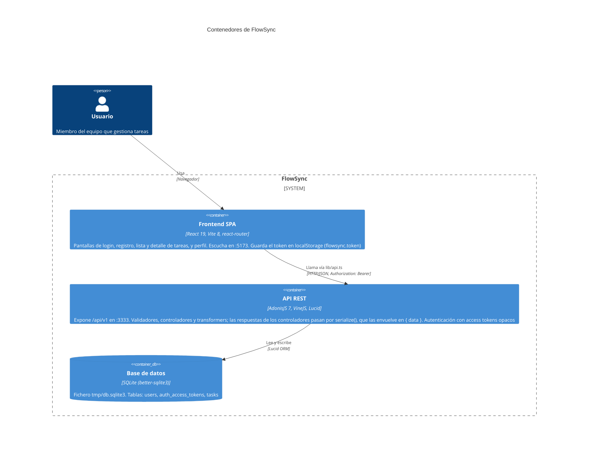
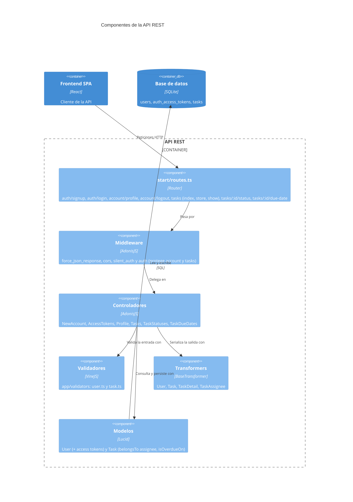
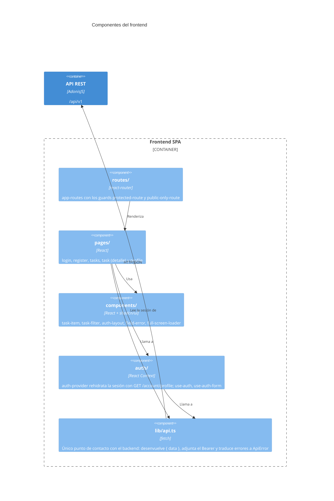

# Arquitectura de FlowSync

Diagrama de contenedores (nivel 2 de C4) de lo que existe hoy en el repo: un frontend React que se ejecuta en el navegador de la persona usuaria, una API AdonisJS que expone `/api/v1` y una base de datos SQLite en fichero. Dentro de cada contenedor se muestran los componentes que se han verificado leyendo el código; no se dibuja ningún servicio externo porque el código no usa ninguno.

## Componentes de la API

Rutas bajo `/api/v1`. Las de `account` y `tasks` pasan por `middleware.auth()`.

## Componentes del frontend

