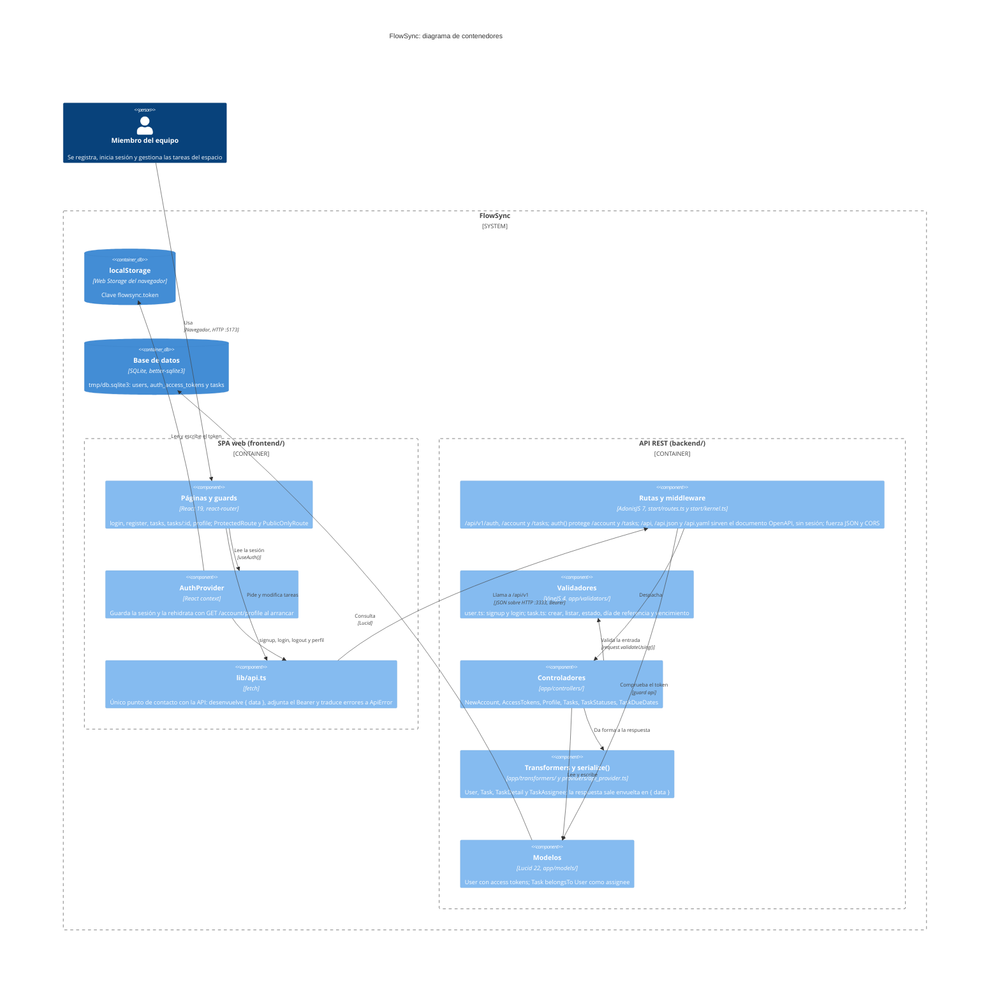

# Arquitectura de FlowSync

Diagrama de contenedores (C4, nivel 2) de FlowSync tal como está hoy en el código: la SPA de React (`frontend/`, puerto 5173), la API de AdonisJS (`backend/`, puerto 3333, con la API bajo `/api/v1` y su documento OpenAPI en `/api`, `/api.json` y `/api.yaml`) y el fichero SQLite `backend/tmp/db.sqlite3`. La SPA y la API se muestran abiertas por capas para seguir el camino de una petición: en el navegador, todo sale por `lib/api.ts` con el token opaco que `AuthProvider` guarda en `localStorage`; en el servidor, rutas → controladores → validadores, modelos Lucid y transformers, que con `serialize()` envuelven la respuesta en `{ data }`. El guard `web` de sesión está configurado pero ninguna ruta lo usa, así que no aparece.

