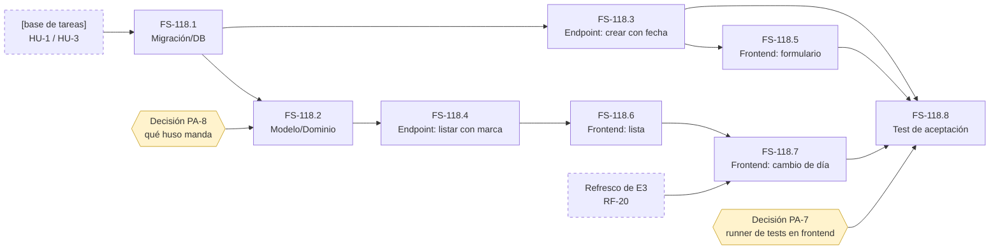

# Tickets de FS-118: Fecha de vencimiento y tareas vencidas

- **Historia:** [FS-118](./us-fechas-vencimiento.md)
- **Épica:** E2 «Gestión de tareas»
- **Convenciones:** [tipos, Definition of Done por tipo y escala de tallas](../convenciones-tickets.md)

**Dependencia externa.** FS-118 se apoya en las historias de E2 que crean la tarea y muestran la lista (HU-3 y HU-1). Todavía no tienen ID, así que aquí aparecen como **[base de tareas]**.

## Tickets

| ID | Título | Tipo | Capa | Criterios que hereda | Bloqueado por |
|---|---|---|---|---|---|
| **FS-118.1** | Guardar una fecha de vencimiento opcional en las tareas | Migración/DB | Migración | CA-1, CA-2 | [base de tareas] |
| **FS-118.2** | Regla de negocio de tarea vencida | Modelo/Dominio | Modelo | CA-3 a CA-8, CA-12, CA-13, CA-15 | FS-118.1 · decisión PA-8 |
| **FS-118.3** | Aceptar y validar la fecha al crear una tarea, y que no se pueda cambiar después | Endpoint/API | Endpoint (crear y modificar tareas) | CA-1, CA-2, CA-9, CA-13, CA-14 | FS-118.1 |
| **FS-118.4** | Incluir la fecha y la marca de vencida en la lista | Endpoint/API | Endpoint (listado) + transformer | CA-1, CA-3 a CA-8, CA-10, CA-17 a CA-19 | FS-118.2 |
| **FS-118.5** | Fecha opcional en el formulario de crear tarea | Frontend | Interfaz (formulario) + `lib/api.ts` | CA-1, CA-2, CA-13 a CA-16 | FS-118.3 |
| **FS-118.6** | Mostrar la fecha y la marca de vencida en la lista | Frontend | Interfaz (lista) | CA-1, CA-3 a CA-7, CA-10, CA-17, CA-19 | FS-118.4 |
| **FS-118.7** | Recalcular la marca cuando cambia el día o el estado con la lista abierta | Frontend | Interfaz (lista) | CA-4, CA-11, CA-12 | FS-118.6 · refresco de E3 (RF-20) |
| **FS-118.8** | Pruebas de aceptación de FS-118 | Test | Backend (funcional) + frontend | CA-1 a CA-19 | FS-118.3 a FS-118.7 · decisión PA-7 |

### Lo que cada ticket añade a la DoD de su tipo

Todo lo de esta lista es entrega, no criterios nuevos.

- **FS-118.1**
  - [ ] Después de migrar, las tareas que ya existían quedan sin fecha (CA-2).
- **FS-118.2**
  - [ ] La regla recibe "hoy" desde fuera en lugar de leerlo del reloj, para poder probar CA-8 y CA-11.
  - [ ] Hay tests para ayer, hoy y mañana, y para tareas en «hecho».
- **FS-118.3**
  - [ ] Hay un test que demuestra que ninguna operación posterior a la creación cambia la fecha (CA-9), incluidos cambiar el estado y reasignar.
  - [ ] El mensaje de fecha inválida está en castellano.
- **FS-118.4**
  - [ ] Hay un test que comprueba que la marca no altera el orden (CA-19).
  - [ ] Hay un test que comprueba que la marca se mantiene al filtrar y al reasignar (CA-17, CA-18).
- **FS-118.5**
  - [ ] Solo se elige el día (CA-15).
  - [ ] Si se rechaza la creación, no se pierde la fecha introducida (CA-16).
  - [ ] Las tareas ya creadas no muestran ningún control para editar la fecha.
- **FS-118.6**
  - [ ] La marca de vencida no depende solo del color: lleva texto o icono.
  - [ ] Una tarea sin fecha no muestra un hueco ni un valor extraño.
- **FS-118.7**
  - [ ] El cambio de día se comprueba simulándolo, sin esperar a medianoche. La prueba automática de CA-11 y CA-12 va en FS-118.8, que es donde se resuelve PA-7.
- **FS-118.8**
  - [ ] El PR incluye una tabla que relaciona cada CA con su test.
  - [ ] CA-17 y CA-18 se prueban cuando existan el filtro (FS-142) y la reasignación (HU-7). Hasta entonces se marcan como pendientes, no como superados.

## Grafo de dependencias

Una flecha `A → B` significa que A bloquea a B. Las cajas con borde discontinuo son dependencias externas a la historia, y los hexágonos son decisiones de producto pendientes. FS-118.4 y FS-118.6 también bloquean a FS-118.8, a través de FS-118.7.

**Camino crítico:** [base de tareas] → FS-118.1 → FS-118.2 → FS-118.4 → FS-118.6 → FS-118.7 → FS-118.8.

## Orden de implementación

| Paso | Ticket | Por qué en este punto |
|---|---|---|
| 0 | Decidir PA-8 y cerrar los criterios [PROPUESTO] | Son lo que más trabajo puede tirar. Cuestan una conversación, no código. |
| 1 | **FS-118.1** Migración | Es la raíz. Solo depende de la base de tareas. |
| 2 | **FS-118.3** Endpoint de creación | Solo necesita FS-118.1 y no depende de PA-8, así que se puede avanzar aunque PA-8 siga abierta. |
| 3 | **FS-118.2** Regla de vencida | Justo después de decidir PA-8. Es el ticket con más lógica y abre la rama más larga. |
| 4 | **FS-118.4** Endpoint de listado | Con él, el backend de la historia queda completo. |
| 5 | **FS-118.5** Formulario | Puede ir en paralelo con los pasos 3 y 4, porque solo depende de FS-118.3. |
| 6 | **FS-118.6** Lista | A partir de aquí la historia se puede usar de principio a fin, salvo el cambio de día. |
| 7 | **FS-118.7** Cambio de día | Va al final porque depende del refresco de E3 y de CA-11 y CA-12, que son [PROPUESTO]. |
| 8 | **FS-118.8** Pruebas de aceptación | Las pruebas de cada capa ya están en la DoD de cada ticket. Este ticket consolida la cobertura criterio a criterio. La parte de frontend espera a PA-7. |

**Con dos personas:**

- **Persona A:** FS-118.1, FS-118.2, FS-118.4 y FS-118.6 (el camino crítico).
- **Persona B:** FS-118.3 y FS-118.5 en cuanto esté FS-118.1. Después, si PA-7 se resuelve montando el runner, ese runner.

**Si PA-8 tarda en decidirse:** con FS-118.1, FS-118.3 y FS-118.5 ya se puede crear una tarea con o sin fecha. Pero CA-1 y CA-2 no se cumplen enteros hasta que la fecha se ve en la lista, y para eso hacen falta FS-118.4 y FS-118.6. *Propuesta pendiente:* partir FS-118.4 para adelantar la parte que muestra la fecha, que no depende de PA-8.

## Estimación y riesgo

| Ticket | Talla | En qué se basa | Riesgo | Nota de riesgo |
|---|---|---|---|---|
| **FS-118.1** | **S** | Hereda dos criterios y sigue un flujo del repo ya conocido: migración y `migration:run`, que regenera `schema.ts`. | 🟢 Bajo | Depende de que exista la tabla de tareas de la base de tareas. |
| **FS-118.2** | **M** | Tiene poco código, pero hereda nueve criterios con casos límite y cada uno necesita su test. | 🔴 Alto | PA-8 está sin decidir y los cálculos con fechas y husos horarios son propensos a errores de un día. |
| **FS-118.3** | **M** | Añade validación nueva, y CA-9 obliga a probar que ninguna otra operación toca la fecha. | 🟠 Medio | La validación de fechas en VineJS 4 difiere de la documentación de la v6. Una fecha sin hora puede desplazarse un día. **Si la base de tareas no ha montado la suite funcional, la estrena este ticket y pasa a L.** |
| **FS-118.4** | **S** | Añade campos a una respuesta que ya existe, mediante un transformer (patrón de `UserTransformer`). | 🟠 Medio | Según cómo se resuelva PA-8, el cálculo de vencida puede moverse al frontend y vaciar el ticket. |
| **FS-118.5** | **M** | Introduce un control de fecha nuevo, probablemente con un componente shadcn que aún no está en el repo. Además, CA-16 y los errores por campo. | 🟠 Medio | Posible desfase de un día entre el navegador y la API. Añade dependencias nuevas. CA-13 a CA-16 son [PROPUESTO]. |
| **FS-118.6** | **S** | Pinta la fecha y la marca en una lista que ya existe. | 🟢 Bajo | Depende de que la lista de la base de tareas esté hecha. |
| **FS-118.7** | **M** | Tiene poco código, pero hay que simular el paso de la medianoche, y se apoya en un refresco de E3 que todavía no está definido. | 🔴 Alto | Depende solo de criterios [PROPUESTO] (CA-11 y CA-12) y de E3. Puede desaparecer o crecer. |
| **FS-118.8** | **L** | Son 19 criterios repartidos en dos capas, y el frontend no tiene runner de tests (PA-7). | 🔴 Alto | Incumple la regla de media jornada. *Propuesta pendiente:* partirlo en un ticket de backend (M) y otro de frontend que espere a PA-7. |

**Reparto:** 3 S, 4 M y 1 L. Hay dos riesgos que afectan a toda la historia: los husos horarios (PA-8) y que la infraestructura de tests todavía no existe.

## Pendiente antes de arrancar

1. **Decidir PA-8.** Bloquea FS-118.2 y condiciona FS-118.3, FS-118.4, FS-118.5 y FS-118.7.
2. **Aprobar o descartar CA-11 a CA-19.** Afectan sobre todo a FS-118.7, FS-118.5 y FS-118.3.
3. **Decidir PA-7.** Bloquea la parte frontend de FS-118.8.
4. **Confirmar que la base de tareas deja montada la suite de tests funcionales.**
5. **Resolver CA-14 frente a CA-15.** Con un selector de día, una fecha imposible no se puede introducir desde la interfaz.
