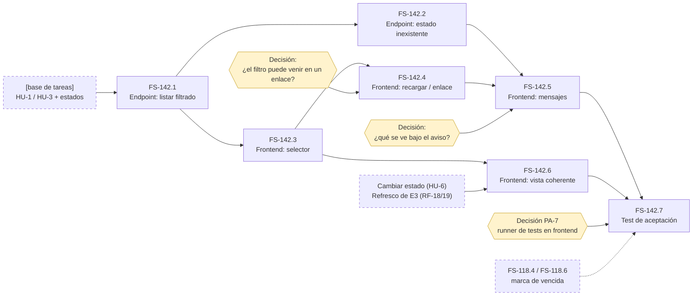

# Tickets de FS-142: Filtrar la lista por estado

- **Historia:** [FS-142](./us-filtrar-por-estado.md)
- **Épica:** E2 «Gestión de tareas»
- **Convenciones:** [tipos, Definition of Done por tipo y escala de tallas](../convenciones-tickets.md)

**Dependencias externas.** FS-142 se apoya en la base de tareas (crear tarea, HU-3; ver la lista, HU-1; los tres estados) y, para algunos criterios, en cambiar el estado (HU-6) y en el refresco de E3 (RF-18 y RF-19). Ninguna tiene ID todavía.

**Sin tickets de Migración/DB ni de Modelo/Dominio.** Filtrar no guarda nada nuevo y los tres estados válidos ya los fija la base de tareas. Comprobar si un estado existe se hace al validar la petición.

## Tickets

| ID | Título | Tipo | Capa | Criterios que hereda | Bloqueado por |
|---|---|---|---|---|---|
| **FS-142.1** | Listar las tareas filtradas por un estado | Endpoint/API | Endpoint (listado) | CA-1, CA-2, CA-3, CA-11, CA-14 | Base de tareas (lista y estados) |
| **FS-142.2** | Rechazar un estado que no existe con un aviso que lo explique | Endpoint/API | Endpoint (listado) + validador | CA-5 | FS-142.1 |
| **FS-142.3** | Selector de filtro por estado en la lista | Frontend | Interfaz (lista) + `lib/api.ts` | CA-1 a CA-4, CA-12 | FS-142.1 |
| **FS-142.4** | Conservar el filtro al recargar y al llegar con él ya puesto | Frontend | Interfaz (lista) | CA-5 (cómo se llega), CA-13 | FS-142.3 · decisión sobre el enlace con filtro |
| **FS-142.5** | Mensajes de lista vacía y de estado inexistente | Frontend | Interfaz (lista) | CA-5, CA-6, CA-7 | FS-142.2, FS-142.4 · decisión sobre qué se ve bajo el aviso |
| **FS-142.6** | Mantener la vista filtrada coherente con los cambios propios y ajenos | Frontend | Interfaz (lista) | CA-8, CA-9, CA-10 | FS-142.3 · cambiar estado (HU-6) · crear tarea (HU-3) · refresco de E3 (RF-18 y RF-19) |
| **FS-142.7** | Pruebas de aceptación de FS-142 | Test | Backend (funcional) + frontend | CA-1 a CA-14 | FS-142.1 a FS-142.6 · decisión PA-7 · FS-118.4 y FS-118.6 (solo para CA-14) |

### Lo que cada ticket añade a la DoD de su tipo

Son puntos de entrega, no criterios nuevos.

- **FS-142.1**
  - [ ] Hay un test por estado y otro para «todas».
  - [ ] Hay un test que comprueba que el orden filtrado coincide con el de «todas» (CA-11).
  - [ ] Filtrar por dos estados a la vez no está soportado, y hay un test que lo demuestra (CA-3).
- **FS-142.2**
  - [ ] El aviso nombra los tres estados válidos.
  - [ ] Hay un test que distingue este caso de un estado válido sin tareas: nunca se devuelve una lista vacía en silencio.
  - [ ] Se prueba de forma explícita que «bloqueado» se trata como estado inexistente.
- **FS-142.3**
  - [ ] Solo se puede elegir un estado a la vez.
  - [ ] La opción activa se ve marcada.
  - [ ] El filtro no se guarda en ningún sitio que compartan las personas (CA-12).
- **FS-142.4**
  - [ ] Se ha comprobado a mano que el filtro se conserva al recargar.
  - [ ] Se ha comprobado a mano que llegar con un estado inexistente muestra el aviso de FS-142.5.
- **FS-142.5**
  - [ ] Los mensajes de «no hay tareas en este estado» y de «este estado no existe» se distinguen a la vista y por el texto.
  - [ ] Volver a «todas» cuesta un clic.
  - [ ] El filtro no cambia nunca sin que la persona lo pida (CA-6).
- **FS-142.6**
  - [ ] Se ha comprobado con dos sesiones a la vez que los cambios ajenos entran y salen de la vista dentro del plazo de frescura.
  - [ ] Al crear una tarea que queda fuera del filtro activo se muestra la confirmación.
- **FS-142.7**
  - [ ] El PR incluye una tabla que relaciona cada CA con su test.
  - [ ] Los criterios cuya dependencia externa todavía no existe se marcan como pendientes, no como superados.

## Grafo de dependencias

Una flecha `A → B` significa que A bloquea a B. La flecha punteada solo afecta a CA-14 dentro de FS-142.7. Fuera de esa prueba, FS-142 no depende de FS-118 y las dos historias se pueden construir en paralelo.

**Camino crítico:** base de tareas → FS-142.1 → FS-142.3 → FS-142.4 → FS-142.5 → FS-142.7.

## Orden de implementación

| Paso | Ticket | Por qué en este punto |
|---|---|---|
| 0 | Decidir lo del enlace, qué se ve bajo el aviso y los criterios [PROPUESTO] (CA-4, CA-6 a CA-9, CA-12, CA-13) | Esas decisiones determinan si FS-142.4, FS-142.5 y FS-142.6 existen. |
| 1 | **FS-142.1** Listar filtrado | Es la raíz. Con este ticket ya se puede filtrar por estado. |
| 2 | **FS-142.2** Estado inexistente | Cierra el backend y cubre CA-5, que pidió el usuario. No depende de ninguna decisión: la API avisa del error haya enlace o no. |
| 3 | **FS-142.3** Selector | A partir de aquí la historia se puede usar (CA-1 a CA-4). |
| 4 | **FS-142.4** Recargar / enlace | Solo si se decide que el filtro viaja en el enlace o se conserva al recargar. Si no, el ticket desaparece. |
| 5 | **FS-142.5** Mensajes | Requiere la vía para llegar al estado inexistente y saber qué se ve bajo el aviso. |
| 6 | **FS-142.6** Vista coherente | Es el último del frontend porque depende de historias que todavía no existen (cambiar estado, E3). |
| 7 | **FS-142.7** Pruebas de aceptación | Consolida la cobertura criterio a criterio. La parte de frontend espera a PA-7. |

**Con dos personas:**

- **Persona A:** FS-142.1 y FS-142.2. Después, FS-142.6 cuando existan sus dependencias.
- **Persona B:** el runner de PA-7 mientras A hace FS-142.1. Después, FS-142.3, FS-142.4 y FS-142.5.

## Estimación y riesgo

| Ticket | Talla | En qué se basa | Riesgo | Nota de riesgo |
|---|---|---|---|---|
| **FS-142.1** | **S** | Es un filtro sobre un listado que ya existe. Hereda cinco criterios sencillos y no guarda nada nuevo. | 🟢 Bajo | CA-11 exige un orden estable: si la base de tareas no lo garantiza (RF-16), el problema aparece aquí. **Si es el primer ticket con tests funcionales, tiene que estrenar la suite y pasa a L.** |
| **FS-142.2** | **S** | Una regla de validación (que el valor esté entre los tres estados) y un test que la distinga de una lista vacía. | 🟠 Medio | Los mensajes por defecto de VineJS están en inglés: hace falta uno propio en castellano. Hay que revisar en los `.d.ts` de VineJS 4 cómo se valida que un valor pertenezca a una lista cerrada. |
| **FS-142.3** | **S** | Un control con cuatro opciones. Probablemente necesita traer un componente shadcn que aún no está en el repo. | 🟢 Bajo | Es un patrón conocido. |
| **FS-142.4** | **S** | Si se decide que sí: guardar el filtro en la dirección de la página y leerlo al cargar. | 🟠 Medio | Bloqueado por la decisión del enlace. Hay que comprobar que el filtro sobrevive a la redirección al login. |
| **FS-142.5** | **S** | Dos mensajes distinguibles y un botón para volver a «todas». | 🟠 Medio | No se puede cerrar hasta decidir qué se ve bajo el aviso. CA-6 y CA-7 son [PROPUESTO]. |
| **FS-142.6** | **M** | Tres criterios que cruzan otras historias, con pruebas en dos sesiones y tareas que entran y salen de la vista. | 🔴 Alto | Depende de HU-6, HU-3 y E3, que no existen todavía. CA-8 y CA-9 son [PROPUESTO], y la alternativa a CA-8 cambiaría el comportamiento. |
| **FS-142.7** | **L** | Son 14 criterios en dos capas, y el frontend no tiene runner de tests. | 🔴 Alto | Incumple la regla de media jornada. *Propuesta pendiente:* partirlo en un ticket de backend (M) y otro de frontend que espere a PA-7. CA-14 espera además a FS-118. |

**Reparto:** 5 S, 1 M y 1 L. Es una historia más ligera que FS-118. El riesgo está en las decisiones pendientes, no en el código.

## Pendiente antes de arrancar

1. **Aprobar o descartar CA-4, CA-6 a CA-9, CA-12 y CA-13.** Condicionan FS-142.4, FS-142.5 y FS-142.6.
2. **Decidir si el filtro puede venir en un enlace.** Determina FS-142.4. Si no puede, al estado inexistente solo se llega forzando la petición; FS-142.2 sigue haciendo falta.
3. **Decidir qué se ve bajo el aviso de estado inexistente.** Bloquea el cierre de FS-142.5.
4. **Decidir PA-7.** Bloquea la parte frontend de FS-142.7.
5. *Propuesta pendiente:* **un único ticket para montar el runner de frontend**, que sirva a FS-118.8 y a FS-142.7. Falta decidir de qué historia cuelga, o si es un ticket técnico aparte.
