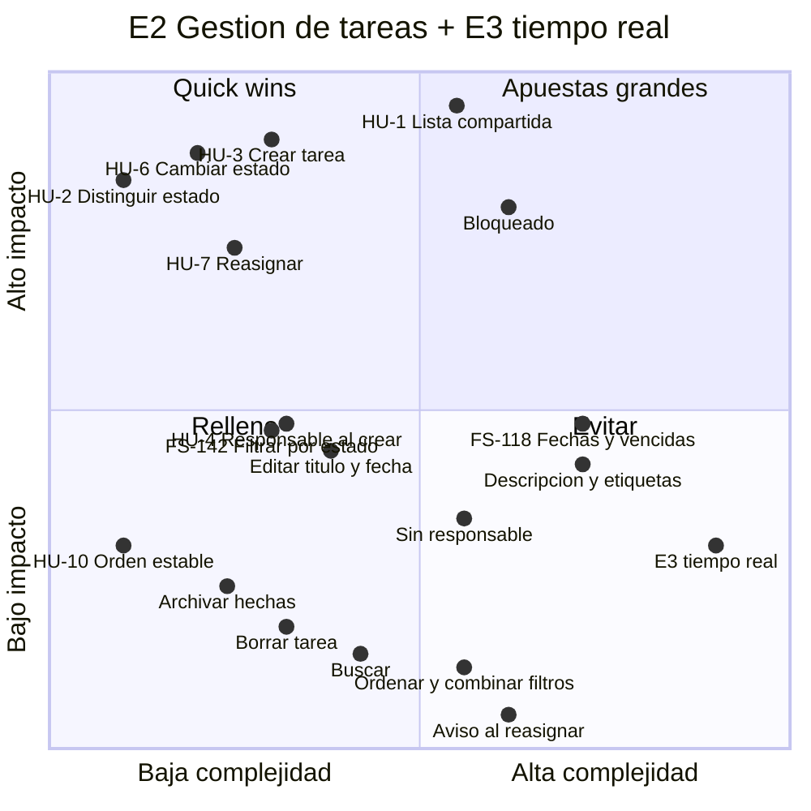

# Priorización de E2 «Gestión de tareas» y del tiempo real de E3

En esta matriz están las historias de E2 que se identificaron al descomponer la épica, tanto las que entran en el MVP como las que se quedan fuera, junto con la sincronización en tiempo real de E3 «Actividad del equipo».

**Qué miden los ejes.** Las posiciones son criterio de producto; no salen de datos de usuarios, porque el primer usuario es un caso de estudio.

- **Impacto:** cuánto ayuda a responder las dos preguntas del [PRD](../prd/flowsync-mvp.md) («¿alguien está ya con esto?» y «¿qué cojo ahora?») y a que el estado se mantenga fresco (riesgo #1).
- **Complejidad:** cuántas capas toca, cuántas incógnitas tiene y si quedan decisiones abiertas. Es la misma lógica que el [t-shirt sizing](./convenciones-tickets.md#escala-de-tallas-t-shirt-sizing).

## Historias

Solo FS-118 y FS-142 tienen ID definitivo y fichero propio. Las demás conservan el número de trabajo (HU-n) con el que se identificaron al descomponer E2.

| Ref. | Historia | ¿En el MVP? |
|---|---|---|
| HU-1 | Ver en una sola lista todas las tareas del equipo | Sí |
| HU-2 | Distinguir en la lista el estado de cada tarea sin abrirla | Sí |
| HU-3 | Crear una tarea escribiendo solo el título, asignada a mí y en «pendiente» | Sí |
| HU-4 | Elegir otro responsable al crear una tarea | Sí |
| FS-118 | Fecha de vencimiento al crear y tareas vencidas marcadas (consolida HU-5 y HU-9) | Sí |
| HU-6 | Cambiar el estado desde la lista en dos clics como máximo | Sí |
| HU-7 | Cambiar el responsable de una tarea | Sí |
| FS-142 | Filtrar la lista por un estado (antes HU-8) | Sí |
| HU-10 | Que la lista mantenga el mismo orden mientras no cambie nada | Sí |
| — | Borrar una tarea | No |
| — | Editar el título o la fecha de una tarea ya creada | No |
| — | Descripción, comentarios, etiquetas o prioridad | No |
| — | Marcar una tarea como «bloqueada» | No |
| — | Buscar tareas por texto | No |
| — | Ordenar la lista a gusto o combinar filtros | No |
| — | Ocultar o archivar las tareas hechas | No |
| — | Dejar una tarea sin responsable | No |
| — | Recibir un aviso cuando me reasignan una tarea | No |
| E3 | Sincronización en tiempo real | No (el MVP cubre E3 solo hasta el umbral de 10 s) |

## Matriz impacto/complejidad

| Elemento | ¿En el MVP? | Impacto | Complejidad | Por qué |
|---|---|---|---|---|
| HU-1 Lista compartida | Sí | Alto | Media | Sin la lista no hay producto. La complejidad es media porque estrena la tabla de tareas y la suite de tests funcionales. |
| ⭐ HU-3 Crear tarea | Sí | Alto | Baja | Con la lista ya hecha, crear una tarea solo con título cuesta poco, y todo lo demás parte de aquí. |
| ⭐ HU-6 Cambiar estado | Sí | Alto | Baja | «En curso» es la señal que el producto existe para dar, y los dos clics son la hipótesis principal. |
| ⭐ HU-2 Distinguir estado | Sí | Alto | Baja | Responde de un vistazo a «¿alguien está con esto?». Es solo presentación. |
| ⭐ HU-7 Reasignar | Sí | Alto | Baja | Como toda tarea tiene responsable, «coger algo» es reasignarlo. Se cambia un único dato. |
| HU-4 Responsable al crear | Sí | Medio | Baja | Es útil, pero reasignar después cubre casi lo mismo. Requiere listar a las personas (RF-8). |
| FS-142 Filtrar por estado | Sí | Medio | Baja | Con listas de 3 a 10 personas ayuda, pero no es crítico. El riesgo está en las decisiones, no en el código. |
| FS-118 Fechas y vencidas | Sí | Medio | Alta | No responde a ninguna de las dos preguntas: es JTBD-5. Es de lo más complejo de E2 por los husos horarios (PA-8). |
| HU-10 Orden estable | Sí | Bajo | Baja | Sale casi gratis con HU-1. |
| Estado «bloqueado» | No | Alto | Media | Es la mitad de la daily que no se resuelve. Técnicamente cuesta poco; lo difícil es decidir qué significa. |
| Editar título y fecha | No | Medio | Baja | Es el primer candidato después del MVP, según el [alcance](../prd/alcance-mvp.md). Editar la fecha obliga a revisar la regla de vencida. |
| Descripción y etiquetas | No | Medio | Alta | Podría ayudar con PA-5 (ver solapamientos), pero añade campos y pantallas. Riesgo de que el alcance crezca. |
| Dejar sin responsable | No | Medio-bajo | Media | Contradice una decisión ya tomada (RF-7 y RF-13) y obliga a revisar varias reglas. |
| Archivar hechas | No | Bajo | Baja | Hoy lo cubre el filtro. Gana valor cuando la lista crece. |
| Borrar tarea | No | Bajo | Baja | Marcarla como hecha ya cierra el trabajo. |
| Buscar | No | Bajo | Baja | Con listas cortas aporta poco. |
| Ordenar y combinar filtros | No | Bajo | Media | Aporta poco y multiplica las combinaciones que hay que probar. |
| E3 tiempo real | No | Bajo-medio | Alta | El umbral de 10 s ya responde a «¿alguien está con esto?», y con 3 husos horarios el uso es sobre todo asíncrono (PA-4). Necesita infraestructura nueva y tests que dependen del tiempo. |
| Aviso al reasignar | No | Negativo | Media | Vuelve a traer las interrupciones que el producto quiere quitar (RF-21). |

**Quick wins (⭐), es decir, alto impacto con baja complejidad:** HU-2, HU-3, HU-6 y HU-7. FS-142 se queda en la frontera: es poco complejo, pero su impacto es medio.

El refresco del MVP en 10 s (RF-18 a RF-20) no entra en la matriz, porque esta solo evalúa el tiempo real. Si se incluyera, quedaría en impacto medio y complejidad media.

## Orden de backlog priorizado

### MVP

El orden sigue primero las dependencias y después los quick wins. FS-118 y FS-142 se mantienen dentro del MVP, en E2.

1. **HU-1 Lista compartida.** Es la base de todo.
   **HU-10 Orden estable.** Va junto a HU-1, porque sale casi gratis con ella. *Propuesta pendiente:* absorberla como criterio de HU-1.
2. ⭐ **HU-3 Crear tarea**
3. ⭐ **HU-6 Cambiar estado**
4. ⭐ **HU-2 Distinguir estado.** Con los pasos 1 a 4 ya se puede validar la hipótesis principal.
5. ⭐ **HU-7 Reasignar**
6. **HU-4 Responsable al crear**
7. **FS-142 Filtrar por estado.** Es poco complejo y no depende de FS-118.
8. **FS-118 Fechas y vencidas.** Es lo más complejo y arriesgado. Antes de empezarlo conviene haber decidido PA-8.

### Después del MVP

Son candidatos, no compromisos. Cada uno depende de lo que se aprenda con el uso.

9. **Editar título y fecha**, si en el uso real molesta no poder corregir.
10. **Estado «bloqueado».** Es la apuesta grande: atacaría la otra mitad de la daily. Necesita una decisión de producto antes que código.
11. **Archivar hechas**, cuando la lista se haga difícil de manejar.
12. **Descripción y etiquetas**, solo si PA-5 demuestra que el título no basta para ver solapamientos.
13. **Borrar tarea**
14. **Buscar**
15. **Dejar sin responsable.** Obliga a reabrir una decisión ya tomada.
16. **E3 tiempo real**, solo si PA-4 muestra que el equipo usa la lista de forma síncrona.

### No hacer

- **Aviso al reasignar:** contradice la propuesta de valor.
- **Ordenar y combinar filtros:** no compensa su coste.

### Dependencia de E3 fuera de esta priorización

FS-118.7 y FS-142.6 dependen del refresco de 10 s del MVP (RF-18 a RF-20, de E3). Ese refresco no se prioriza aquí, porque esta matriz solo cubre E2 y el tiempo real de E3. Mientras no exista, esos dos tickets siguen bloqueados.

### Nota sobre el orden

FS-118 y FS-142 se refinaron antes que el resto porque era razonable quitar pronto la incertidumbre de lo más complejo. En el sprint, sin embargo, conviene construir antes los quick wins, que son la base de la que dependen las dos historias.
